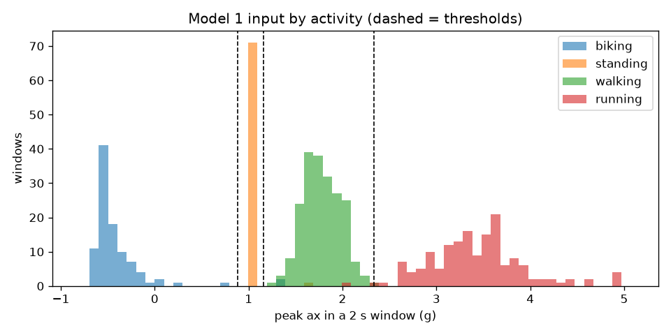
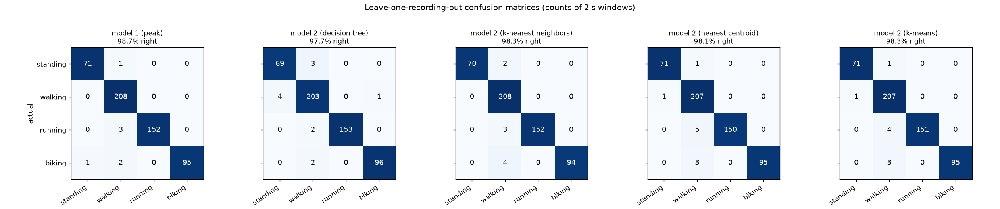
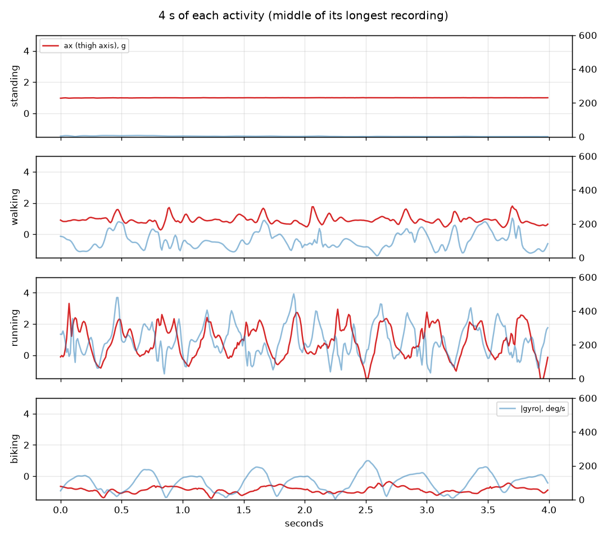

# Gait Wearable

A thigh-worn wearable built from an Arduino UNO Q and an MPU-6050 IMU that tells apart
**standing, walking, running and biking** (air-biking on your back). Two classifiers, no
neural nets:

1. **Model 1** uses a single number: the peak acceleration along the thigh axis in each
   2-second window, sorted into activities by three thresholds.
2. **Model 2** uses all six IMU outputs (about 50 features per window) with methods from
   class: decision tree, k-nearest neighbors, nearest centroid and k-means. The best one
   is kept.

The wearable records, classifies and shows the current activity on its LED matrix by
itself. A laptop dashboard shows the live signals and controls recordings over MQTT.

## Results

14 recordings (standing ×4, walking ×4, running ×3, biking ×3), 533 windows. Every
recording is scored by models trained only on the *other* recordings.

| Model | Windows right |
|---|---|
| Model 1 (peak on the thigh axis) | **98.7 %** |
| Model 2: k-nearest neighbors (kept) | 98.3 % |
| Model 2: k-means | 98.3 % |
| Model 2: nearest centroid | 98.1 % |
| Model 2: decision tree | 97.7 % |

Model 1 does about as well as model 2 because, with the sensor's X axis along the thigh,
the four activities land in separate ranges of one number:



| Activity | Typical peak on X | Why |
|---|---|---|
| biking (on your back) | about −0.5 g | the thigh points up, so gravity pulls along −X |
| standing | 1.0 g | the thigh is vertical: just gravity |
| walking | 1.3 to 2.3 g | gravity plus heel strikes |
| running | 2.5 to 5 g | much bigger impacts |

Thresholds learned: biking < 0.88 g ≤ standing < 1.16 g ≤ walking < 2.34 g ≤ running.



The few mistakes are mostly windows called "walking": the start or end of a running or
biking recording, or shifting weight while standing.



Full numbers and the decision tree's questions: [models/scores.md](models/scores.md).

### Limitations

- **Biking means air-biking on your back.** On a real bike the thigh is near horizontal,
  so its axis reads about +0.3 to +0.5 g: model 1 would call that standing, and model 2
  has never seen it. Real-bike recordings would be needed.
- One person's data. A recording of someone else would show whether it generalizes.
- About 2 to 3 s of delay when switching activities (2 s windows, plus smoothing over the
  last 3 answers).

## Hardware

- Arduino UNO Q, MPU-6050 (GY-521 breakout), USB-C power bank, 3D-printed enclosure
  strapped to the front of the thigh.
- Wiring: VCC → 3.3V, GND → GND, SDA → SDA, SCL → SCL (pins next to AREF). AD0 unconnected.
- The IMU's **X arrow points along the thigh toward the hip**: standing reads +1 g on X.
- 100 Hz, ±8 g, ±1000 °/s. The highest values recorded were about 5 g and 500 °/s.

## How it works

```
MPU-6050 --I2C--> sketch (STM32, our MPU6050 driver, reads the IMU's FIFO)
                    --Bridge--> python/main.py on the UNO Q (Linux)
                                  |- record: CSV files on the board, started/stopped over MQTT
                                  |- classify: both models every second (numpy only)
                                  |- LED matrix: animation for the current activity
                                  '- MQTT (broker.hivemq.com, ME193/Jude/gait) --> laptop
laptop: dashboard.py (live view), gait.py (record), pull_data.py, train.py, push_models.py
```

- Each recording is cut into 2 s windows every 1 s; the first and last 3 s are dropped.
- `train.py` exports both models to `models/gait_models.json`, and `gait_models.py` runs
  them with numpy only, so the board needs no scikit-learn. The dashboard runs the same
  file, so the laptop and the board always agree.
- The board app lives in a separate private App Lab repo; `unoq/` is a snapshot of it.

## Setup

```powershell
cd "Gait Wearable"
py -3 -m venv gaitVenv
gaitVenv\Scripts\activate
pip install -r requirements.txt
pytest                      # 35 tests, no hardware needed
```

The board app is deployed with `python tools/deploy.py gait-wearable` from the
`ArduinoApps` folder.

## Using it

```powershell
python dashboard.py                    # live graphs, gait, model 1 bands, record buttons
python gait.py watch                   # status in the terminal
python gait.py record walking 90 --delay 10    # 10 s to get going, record 90 s
python gait.py demo                    # cycle the LED matrix animations

python pull_data.py --clear-board      # copy recordings into data/, then clear the board
python train.py                        # scores + figures + models/
python push_models.py                  # send the models to the wearable
```

`python dashboard.py --fake --models data_synthetic/models` runs without the board
(after `python synthetic.py` and `python train.py --data data_synthetic --models data_synthetic/models`).

## Files

| File | Job |
|---|---|
| `config.py` | Every setting for the laptop side (broker, window size, thigh axis) |
| `gait.py` | Record / watch / show animations over MQTT |
| `dashboard.py` | Live window: signals, gait, timeline, model 1's view, record buttons |
| `live.py` | Buffers the live stream for the dashboard |
| `features_core.py` | Per-window features (shared with the board) |
| `features.py` | Recordings → windows → feature table for training |
| `model_peak.py` | Model 1: thresholds on the peak |
| `model_kmeans.py` | k-means used as a classifier |
| `train.py` | Leave-one-recording-out scores, figures, model export |
| `gait_models.py` | Runs the exported models with numpy only (shared with the board) |
| `pull_data.py`, `push_models.py` | Copy recordings off / models onto the board |
| `synthetic.py` | Fake recordings for tests |
| `data/` | The recordings (`<activity>_<date-time>.csv`, 100 Hz) |
| `models/` | Trained models, figures, `scores.md` |
| `unoq/` | Snapshot of the board app: MPU-6050 driver, sketch, Python, LED matrix art |
| `plan.md` | Design decisions and the build log |

## Troubleshooting

- **Dashboard says OFFLINE:** restart the Gait Wearable app in App Lab (it may have
  started before Wi-Fi, or the sumo app is the board's default after a reboot).
- **Board app runs but sends no data:** the sketch–Linux link can get out of sync after a
  deploy (`journalctl -u arduino-router` shows "invalid packet"). Power-cycle the board.
- **deploy / pull says "no answer":** the reason is printed next to it. `JudeUnoQ.local`
  is tried first, then the IPs in `ArduinoApps/tools/board_secrets.py`.
- **MQTT doesn't connect:** the public broker may be down; change `BROKER_HOST` in
  `config.py` and the board's `main.py` together.
