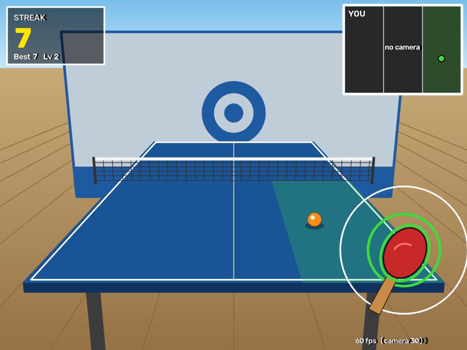

# Ping Pong: ME193 midterm

Solo virtual ping pong against a wall, in the style of Wii Sports Resort table tennis. A **LEGO
Double Motor is the paddle**: its IMU detects your swing. The **webcam** tracks your wrist so you
have to be in the right spot, and reads an **AprilTag** to pick the level and start the game. The
current **streak is published live over MQTT**. The paddle **buzzes and lights up** when you hit,
and the game has **music, my own recorded sound effects and an announcer**.



## How to play

1. **Start screen:** hold the AprilTag up to the camera in the **left, middle or right** third of
   the screen (easy / medium / hard). The announcer calls the level and a ring fills; hold it for
   1.5 s to start. Keys `1` `2` `3` also work.
2. The ball comes off the wall, **bounces on your side** and comes at you down one of three
   **lanes**. Move your hand so the red paddle is in that lane.
3. **Swing the Double Motor** as the white timing ring closes onto the target.
4. A hit sends the ball back to the wall and adds 1 to your **streak**. The ball keeps coming
   until one gets past you, which resets the streak to 0.

A swing that's too early or in the wrong lane is a **whiff**: you get feedback, but the ball keeps
coming and you can swing again. Only a ball that gets past you ends the streak.

| Level | Ball wall → you | Helpers (target ring, timing ring, lane highlight) |
|---|---|---|
| Easy | 1.3 s | on |
| Medium | 1.0 s | on |
| Hard | 0.75 s, **3% faster every hit** in a row (top speed 0.55 s; resets on a miss) | **off**: read the ball |

## How the assignment requirements are met

| Requirement | How |
|---|---|
| **IMU: is the person swinging?** | `swing.py`: a swing needs the gyro over 600 (the paddle rotating) **and** the accelerometer over 3 g within 0.15 s (it's being whipped through an arc), then a 0.4 s cooldown. The thresholds come from recordings of the real paddle (still / walking / wiggling / soft and hard swings, in `tests/fixtures/`). The accelerometer check stops twisting the motor in place from counting. The IMU is read at ~63 Hz (15 ms notifications instead of the default 100 ms). |
| **Pose: is the paddle in the right place?** | `pose_tracker.py`: MediaPipe Pose tracks the right wrist. Its screen third is its lane, and a hit needs the wrist in the ball's lane **at the moment of the swing**. Runs on its own thread, so camera and pose don't hold back drawing (the game targets 60 fps; the FPS counter shows it). |
| **AprilTag: level (ball speed) and start** | `level_tags.py`: one tag (36h11, id 0). The column it's held in picks the level; holding it 1.5 s starts the game. |
| **Live score over MQTT** | `scoreboard.py`: publishes the **current streak as a float** (`"3.0"`, back to `"0.0"` after a miss) to `ME193/Rogers/Jude` on `test.mosquitto.org` whenever it changes. |
| **Something new / cool** | Haptic + light feedback in the paddle, a 3D table renderer, my own recorded audio with an announcer (below). |

## Beyond what we did in class

- **Haptic feedback** (`paddle_feedback.py`): a hit spins both Double Motor outputs in opposite
  directions for 90 ms (a jolt in your hand) and flashes its light green. A miss gives a longer,
  weaker buzz and a red flash. Commands go out from a background thread in one Bluetooth packet, so
  the game never waits on BLE.
- **Wii-style 3D view** (`table_view.py`): a pinhole camera projects a regulation table (2.74 × 1.525 m)
  in real perspective. The ball follows real arcs with a bounce on each half, casts a shadow and
  passes behind the net. The paddle follows your wrist, tilts toward the outer lanes and animates a
  forehand / backhand swing.
- **My own sound effects + announcer** (`record_sfx.py`, `audio.py`): every sound effect and voice
  line is recorded on a headset mic with a tool that trims the silence (measuring the room's noise
  floor), fades and normalises it, and can plot its spectrogram. The announcer calls the level on
  the start screen and the reason for each miss ("Too slow!", "Wrong side!"). Several takes of each
  sound are picked at random. Each level has its own song.
- **Tested**: 193 pytest tests cover the swing detector (against the real recordings), game rules,
  lanes, tags, MQTT publishing, the 3D maths and the audio clean-up, with keyboard, mouse and fake
  hardware standing in for the paddle and camera.

## Setup

From the repo root, with the course virtual environment:

```
my_env\Scripts\activate.bat
pip install -r "ping pong/requirements.txt"
cd "ping pong"
python level_tags.py --make     # prints the start tag to tags/start_tag.png
```

**Hardware:**
- LEGO Double Motor with the **green 0026** Connection Card, held by a grip (set in `config.py`). Keep
  nothing structural on its two output axles: they spin for the haptics.
- A webcam. Stand where it can see your right arm move across the frame.
- Speakers. A headset mic is only needed to record new sounds.

**Music:** the three songs aren't in the repo (they're third-party tracks). Put them in `sounds/` as
`music1.mp3` (easy), `music2.mp3` (medium) and `music3.mp3` (hard). See `sounds/CREDITS.md` for the
tracks. The game runs fine without them.

## Running

```
python main.py                      # the full game
```

| Option | What it does |
|---|---|
| `--fake-imu` | space bar = swing (no paddle needed) |
| `--fake-pose` | the mouse is your wrist |
| `--no-pose` | don't check the lane |
| `--level 1/2/3` | skip the start screen |
| `--camera 1` | another webcam (e.g. a phone via Camo) |
| `--no-mqtt` / `--no-audio` / `--no-haptics` | turn those off |
| `--view classic` | the earlier view: ball drawn over the full webcam image |

**Keys:** `space` swing (with `--fake-imu`), `1` `2` `3` start a level, `r` back to the start screen, `q` quit.

**Watch the live score** from a second terminal:
```
cd mqtt
python publish.py listen ME193/Rogers/Jude
```

**Hardware checks** (each module also runs on its own):

| Command | Checks |
|---|---|
| `python imu_paddle.py live` | paddle connects, sample rate |
| `python swing.py` | prints `SWING` once per swing |
| `python paddle_feedback.py` | buzzing doesn't slow the IMU or set off false swings |
| `python pose_tracker.py` | wrist tracking, lanes, ms per frame |
| `python level_tags.py` | tag detection and which level each column picks |
| `python scoreboard.py 3` | publishes `3.0` to the topic |
| `python audio.py` | plays every sound and song it finds |
| `python record_sfx.py --list` | which sounds are recorded |

## Files

| File | Job |
|---|---|
| `main.py` | the game loop: inputs, rules, drawing, audio, MQTT |
| `config.py` | every tunable number (thresholds, speeds, windows, volumes, topic...) |
| `game.py` | the rules: ball, hit window, lanes, whiffs, streak, hard-mode speed-up (pure logic) |
| `swing.py` | IMU samples → swing events (pure logic) |
| `imu_paddle.py` | reads the Double Motor IMU; records / plots CSVs |
| `paddle_feedback.py` | haptic buzz + light |
| `pose_tracker.py` | MediaPipe wrist tracking, lanes, smoothing |
| `camera_worker.py` | camera + pose on a background thread |
| `level_tags.py` | AprilTag start / level picker |
| `scoreboard.py` | MQTT streak publisher |
| `table_view.py` | the 3D table renderer |
| `audio.py`, `record_sfx.py` | playback; recording your own sounds |
| `lelib.py`, `mqttlib.py` | course libraries (LEGO BLE, MQTT) |
| `tests/` | `pytest tests` (193 tests) |
| `PLAN.md` | the phase-by-phase development log, with the reasoning and numbers behind each decision |

## Credits

Music, from freetouse.com: *Cloud* by Lukrembo (easy), *Sunlight* by Luke Bergs (medium), *Off Road* by
Aylex (hard). All sound effects and announcer lines were recorded by me.
